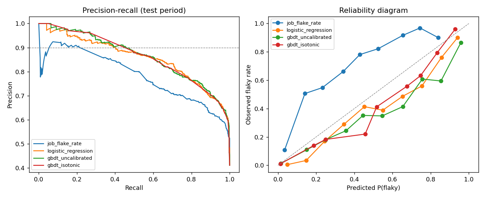

# Test Intelligence Platform

Quality analytics and **flaky-failure triage** on large-scale, real CI test data.

The platform ingests every build of the OpenStack CI system (OpenDev Zuul, public API),
stores it as Parquet queried in place with DuckDB, and learns to tell **flaky failures**
(the same job passes on a re-run of identical code) from **consistent failures** (real
breakage), so engineers only investigate failures that are likely real.

| | |
|---|---|
| Data | 940,000 builds, 90 days (2026-07-22 → 2026-10-20), 529 projects, 3,530 jobs |
| Labelled failures | 13,425 (labels derived automatically from developer re-checks) |
| Ingest → dataset | ~10 min crawl; dataset build 6 s on a laptop (DuckDB over Parquet) |

## Results (temporal split: train Aug 5 – Sep 23, test Oct 6 – Oct 17)

Voting jobs, i.e. the failures that block merges and that an auto-recheck policy would act on:

| Model | ROC-AUC | PR-AUC | Brier ↓ | ECE ↓ | Recall @ 90% precision |
|---|---|---|---|---|---|
| Prior (base rate) | 0.500 | 0.754 | 0.207 | 0.148 | 0.00 |
| Job flake-rate heuristic | 0.680 | 0.854 | 0.345 | 0.404 | 0.27 |
| Logistic regression | 0.760 | 0.900 | 0.163 | 0.086 | 0.51 |
| GBDT | 0.802 | 0.919 | 0.142 | 0.085 | 0.61 |
| **GBDT + isotonic calibration** | **0.801** | 0.907 | **0.137** | **0.037** | **0.61** |

**Reading:** at ≤10% false "flaky" verdicts, the model can auto-handle 61% of flaky
voting-job failures, compared with 27% for the per-job flake-rate rule CI teams typically use.
Calibration cuts ECE from 0.085 to 0.037, so a score of 0.8 really means roughly 80%.
Metrics for all failures (incl. non-voting) are in [reports/flaky_metrics.json](reports/flaky_metrics.json).



### Findings worth discussing

- **Voting vs non-voting jobs are different populations.** Non-voting failures are only 27%
  flaky (mostly persistently broken experimental jobs); voting failures are 83% flaky.
  Pooling them inflates ROC-AUC (0.905 overall vs 0.801 on voting jobs), so we report both.
- **Gate failures are 92% flaky.** The change already passed `check`, so a `gate` failure is
  most often environmental. This is the cheapest high-precision rule available.
- **Label drift.** The weekly flaky rate falls from 55–70% to 38–44% in the last two weeks
  (around the OpenStack release window, which is a hypothesis we have not verified). Uncalibrated
  models over-predict flakiness on the test period; isotonic calibration fitted on the most
  recent validation period corrects most of it. This argues for regular re-calibration in production.
- **Top features** (permutation importance on PR-AUC): voting, the job's 7-day failure rate,
  the share of *other* jobs in the same buildset that failed, and patchset number.
  Many co-failing jobs indicates infrastructure trouble, and early patchsets are more likely real bugs.

## Method

**Labels** ([dataset.py](src/tip/flaky/dataset.py)). For a failed final build of job *J* on
patchset *P*: `flaky = 1` if *J* later succeeds on *P*; `flaky = 0` if it is re-run and never
succeeds. Failures that are never re-run are unlabelled. The last 3 days are censored (not
enough time to be re-run).

**No leakage.** All 24 features are computed *as of* the failure's end time with DuckDB
`RANGE` window frames. A past failure's flaky label enters the history only when the passing
re-run finished, not when the failure happened. Unit tests check this
([tests/test_dataset.py](tests/test_dataset.py)). Evaluation is strictly temporal
(70/15/15 by time), never random.

**Limitations.** (1) Selection bias: developers re-check mostly when they already suspect
flakiness. (2) A re-check runs against a newer branch tip, so "same patchset" is not exactly
"same code". (3) Job-level, not test-case-level: per-test results live in the logs (next phase).

## Architecture

```
Zuul REST API ──► crawler (id-cursor paging, incremental + backfill, retries)
                      │
                      ▼
            data/raw/builds/*.parquet  (immutable, deduplicated on read)
                      │  DuckDB views (no load step)
                      ▼
      labels + as-of features ──► GBDT + isotonic calibration ──► models/, reports/
                      │                                              │
                      └────────────────► Streamlit dashboard ◄───────┘
                      overview · job health · triage queue · model report
```

## Run it

```bash
python -m venv .venv && .venv/Scripts/activate      # Windows; use bin/activate elsewhere
pip install -e ".[dashboard,dev]"

tip ingest --days 90      # crawl (incremental on re-run)
tip stats
tip dataset               # build labelled triage dataset
tip train                 # train, evaluate, write reports/
streamlit run dashboard/app.py
pytest
```

With Docker: `docker compose --profile pipeline run --rm pipeline`, then `docker compose up dashboard`
(http://localhost:8501).

## Roadmap

- [x] **Phase 1:** ingestion, warehouse, flaky-failure triage, dashboard, Docker
- [ ] **Phase 2:** anomaly detection on job duration / failure-rate time series (regression detection)
- [ ] **Phase 3:** log-based failure clustering (Drain templates → embeddings → HDBSCAN) for root-cause grouping
- [ ] **Phase 4:** release-confidence estimation: calibrated P(candidate is good) from buildset-level test evidence
- [ ] **Phase 5:** Kubernetes deployment (Helm, CronJob ingestion, FastAPI scoring service, Prometheus), scalability benchmarks
